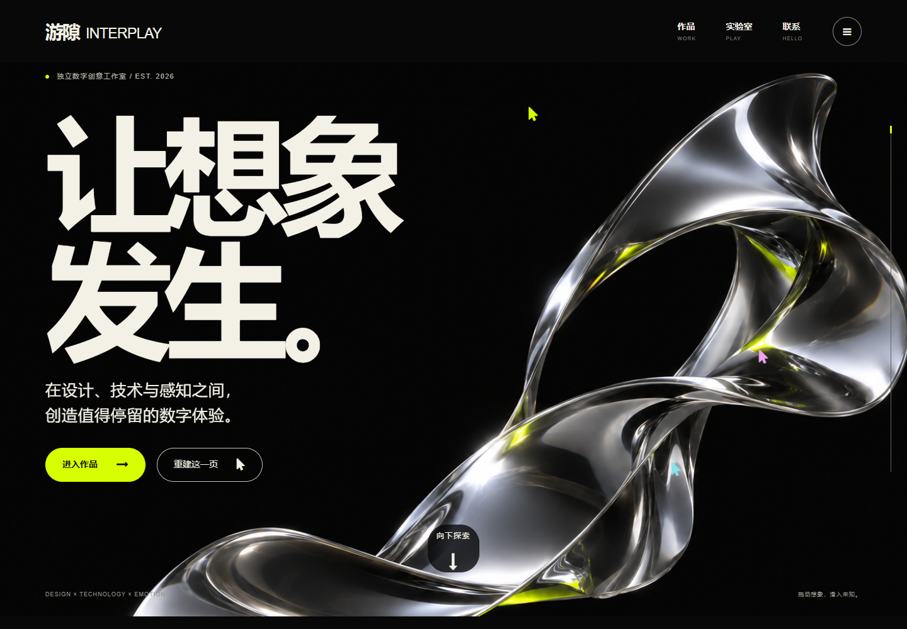

# 游隙 INTERPLAY

一个以液态金属、黑色与骨白为视觉核心的中文互动创意网站。通过滚动叙事、作品画廊和可操作的视觉实验，把“让想象发生”变成可参与的体验。

**[打开网站](https://zjmnb66611.github.io/interplay-creative-studio/)**

## 内容与交互

- 八个主要区域：首屏、创作观点、精选作品、横向视觉档案、创作方法、互动实验、关于和联系。
- 六张独立艺术图、四件有完整说明的概念作品。
- 鼠标视差、磁吸按钮、滚动渐入与阅读进度。
- 可触摸、可按键操作的横向作品画廊。
- 作品详情弹窗、下一作品切换、服务内容展开。
- 雕塑图像透视拖动、三种光线色调、重置视角。
- 接入用户提供的 Swarm Cursors：点击“重建这一页”，或按 `Alt + Shift + S`；按 `Esc` 返回。
- 创意简报：填写、预览、修改、下载 TXT，全部在浏览器本地完成。
- 手机、平板、桌面响应式布局，支持减少动态效果与键盘焦点。

雕塑实验使用艺术图像的透视变化，而非三维网格模型。所展示项目为概念创作，表单不会发送邮件或上传内容。

## 本地打开

克隆或完整下载仓库后，直接使用 Chrome / Edge 打开 `index.html`。无需 Node.js、依赖安装或本地服务器。

页面保留 Tailwind CDN 与 Font Awesome CDN，并为布局和图标提供本地回退。外部 CDN 不可用时，主要内容和交互仍可运行。

## 文件

- `index.html`：语义结构与中文内容。
- `styles.css`：视觉、布局、响应式、减少动态效果。
- `app.js`：交互、作品数据与本地简报下载。
- `assets/`：独立生成的艺术图片。
- `vendor/`：Swarm Cursors、原项目致谢、Font Awesome 本地回退。
- `素材说明.md`：图像生成工具与中文提示词记录。
- `THIRD_PARTY_NOTICES.md`：第三方组件来源与授权状态。

## 验证

本机 Chromium 完成 25 项核心流程检查，覆盖菜单、详情、画廊、折叠区、拖动、色调、重置、简报预览和下载、光标重建与 Esc 返回、手机触摸、减少动态效果。JavaScript 错误为 0。

320、360、390、768、1024、1440 像素宽度检查无横向页面溢出；外部 HTTPS 资源被阻断时，本地图片、字体和主要交互正常。

## 素材与致谢

艺术图片由内建 ImageGen 辅助生成。光标群的动效设计来自 Joel Califa 的 Swarm，网页适配源自 Swarm Rebuild，使用的脚本来自用户提供的 reveal-cursors 源码包，原始致谢完整保留。

该源包的 README 标注 `License: pending`。本仓库保留原第三方组件的授权状态，不对整个仓库另行声明统一开源许可证；复用前请阅读 [第三方说明](THIRD_PARTY_NOTICES.md) 和 [原始致谢](vendor/CREDITS.md)。
